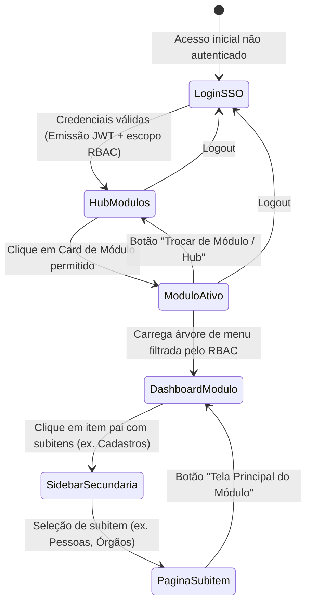

# SPEC-00: Especificação Mestre da Plataforma SECP (Sistema de Controle e Processos)

- **Identificador**: `SPEC-00-PLATFORM-CORE`
- **Versão**: `1.0.0`
- **Status**: `APROVADO PARA IMPLEMENTAÇÃO`
- **Padrão Arquitetural**: `Arquitetura Hexagonal (Ports & Adapters) + SOLID + Spec-Driven Development (SDD)`

---

## 1. Visão Geral do Ecossistema SECP

O **SECP (Sistema de Controle e Processos)** é uma plataforma corporativa/governamental multi-módulo e multi-órgão (Multi-Tenant por Órgão e Unidade), com inspiração direta na ergonomia visual do **CatuPonto**. O acesso ocorre por meio de **Autenticação Única (SSO)** seguida por um **Hub Central de Módulos (Launcher)**, onde o servidor/gestor visualiza exclusivamente os módulos habilitados pelo motor **RBAC (Role-Based Access Control)**.

### 1.1 Catálogo Oficial dos 6 Módulos do Ecossistema

| Código (`slug`) | Nome do Módulo | Cor Temática (Hex) | Token Tailwind | Ícone | Escopo Funcional Principal |
| :--- | :--- | :--- | :--- | :--- | :--- |
| `secp-identidade` | **SECP Identidade** | `#4F46E5` (Índigo/Roxo Escuro) | `indigo-600` | `shield-check` | Gestão centralizada de usuários, perfis, papéis e permissões granulares via RBAC por módulo, órgão e unidade. |
| `secp-ponto` | **SECP Ponto** | `#0891B2` (Azul Petróleo/Ciano) | `cyan-600` | `clock` | Ponto eletrônico, espelho de ponto, registro de batidas, abonos, justificativas, escalas e banco de horas. |
| `secp-folha` | **SECP Folha** | `#059669` (Verde Esmeralda) | `emerald-600` | `banknotes` | Apoio à folha de pagamento, eventos financeiros, rubricas, conferência de cálculos e fechamento mensal. |
| `secp-ferias` | **SECP Férias** | `#D97706` (Âmbar/Laranja) | `amber-600` | `sun` | Períodos aquisitivos, programação, solicitação, aprovação e escala de férias, folgas e licenças. |
| `secp-contracheque` | **SECP Contracheque** | `#2563EB` (Azul Royal) | `blue-600` | `document-text` | Portal do servidor para consulta, visualização detalhada e emissão em PDF de contracheques e informes anuais. |
| `secp-hora-extra` | **SECP Hora Extra** | `#DC2626` (Carmesim/Vermelho) | `red-600` | `bolt` | Solicitação de horas extras, aprovação hierárquica multinível, validação de teto orçamentário por órgão/unidade e envio automático para folha/ponto. |

---

## 2. Fluxo de Autenticação (SSO) e Contexto Organizacional



### 2.1 Regras de Negócio de Autenticação e Sessão
- **RN-AUTH-01 (SSO Único)**: O usuário autentica-se uma única vez na tela de Login SSO informando credencial institucional (ou selecionando um perfil de simulação RBAC em ambiente de homologação).
- **RN-AUTH-02 (Contexto de Órgão e Unidade)**: Todo token de sessão carrega o `orgao_id` e `unidade_id` ativos. Ao alternar de Órgão/Unidade no seletor da Header Global, as permissões RBAC e os dados exibidos são recalculados imediatamente para o novo escopo organizacional.
- **RN-AUTH-03 (Visibilidade Restrita no Hub)**: No Hub Central de Módulos, o backend retorna apenas os módulos para os quais o usuário detém a permissão `<modulo_slug>:access` no órgão/unidade ativo.

---

## 3. Modelo de Controle de Acesso Baseado em Papéis (RBAC Granular)

O modelo RBAC do **SECP Identidade** opera em 4 dimensões:
1. **Sujeito (`User`)**: Servidor ou colaborador identificado por matrícula/CPF.
2. **Escopo Organizacional (`Tenant Scope`)**: `Orgao` (ex: *Secretaria de Administração*, *Secretaria de Saúde*) e `Unidade` (ex: *Paço Municipal*, *UPA Norte*).
3. **Papel (`Role`)**: Agrupador de permissões (ex: `ADMIN_GERAL`, `GESTOR_RH`, `COORDENADOR_UNIDADE`, `SERVIDOR_PUBLICO`).
4. **Permissão Atômica (`Permission`)**: Formato canônico `<modulo>:<recurso>:<acao>` (ex: `secp-ponto:cadastros.pessoas:read`, `secp-hora-extra:aprovacoes:approve`).

### 3.1 Matriz RBAC de Referência por Papel

| Papel (`role_code`) | Módulos Visíveis no Hub | Subitens Visíveis em `Cadastros` | Capacidades Especiais |
| :--- | :--- | :--- | :--- |
| `ADMIN_GERAL` | Todos os 6 módulos (`Identidade`, `Ponto`, `Folha`, `Férias`, `Contracheque`, `Hora Extra`) | *Pessoas, Departamentos, Órgãos, Unidades, Cargos, Funções, Feriados, Horários/Escalas, Relógios REP, Rubricas, Tetos Orçamentários* | Gestão completa de RBAC e auditoria cross-órgão. |
| `GESTOR_RH` | `Ponto`, `Folha`, `Férias`, `Contracheque`, `Hora Extra` (5 módulos — sem `Identidade`) | *Pessoas, Departamentos, Cargos, Funções, Feriados, Horários/Escalas* | Fechamento de ponto, conferência de folha e homologação de férias. |
| `COORDENADOR_UNIDADE` | `Ponto`, `Férias`, `Contracheque`, `Hora Extra` (4 módulos) | *Pessoas, Departamentos, Unidades, Feriados* | Aprovação de 1º nível de horas extras e abonos da sua unidade. |
| `SERVIDOR` | `Ponto`, `Férias`, `Contracheque` (3 módulos — portal de autoatendimento) | Nenhum item de cadastro estrutural (acessa apenas *Meu Espelho*, *Minhas Férias*, *Meu Contracheque*) | Consulta e solicitação própria. |

---

## 4. Anatomia da Interface e Comportamento de Navegação (Padrão CatuPonto)

### 4.1 Header Global (Ponta a Ponta — Full Width `h-16`)
- Fixa no topo (`height: 64px` / `h-16`), atravessando 100% da largura da viewport (`w-full`).
- **Esquerda**:
  - Botão de colapso/expansão da Sidebar Primária.
  - Logotipo oficial **SECP** + Badge colorido dinâmico do **Módulo Ativo** (aplicando a cor temática exata do módulo selecionado, ex: `#4F46E5` no SECP Identidade ou `#0891B2` no SECP Ponto).
- **Direita**:
  - **Seletor de Órgão/Unidade**: Dropdown permitindo alternar o contexto organizacional ativo.
  - **Botão "Tela Principal do Módulo"**: Redireciona instantaneamente para o Dashboard raiz do módulo atual e fecha a Sidebar Secundária.
  - **Botão "Trocar de Módulo / Hub"**: Retorna imediatamente para a visão do Launcher (Hub Central com os Cards coloridos dos módulos).
  - **Botão do Copiloto Normativo (SRAG)**: Abre o painel de consulta inteligente ancorada em legislação.
  - **Notificações e Perfil do Usuário**: Exibe avatar, papel RBAC atual, seletor rápido de simulação RBAC e botão de **Logout**.

### 4.2 Sidebar Primária (Menu Lateral Principal Colapsável)
- Barra vertical fixa à esquerda (`calc(100vh - 4rem)`), com transição suave de largura (`transition-all duration-200 ease-in-out`):
  - **Modo Expandido (`w-64` / `256px`)**: Exibe o ícone alinhado à esquerda + rótulo textual do item (*Dashboard, Cadastros, Movimentações, Relatórios, Configurações*) + indicador de seta (`chevron-right`) caso o item possua subitens.
  - **Modo Colapsado (`w-20` / `80px`)**: Oculta os rótulos textuais e indicadores secundários, exibindo apenas os ícones centralizados com *tooltip* nativo/flutuante ao passar o mouse.
- O item ativo recebe destaque visual com a cor temática do módulo ativo.

### 4.3 Sidebar Secundária Contextual (Sub-barra Lateral de Subitens `w-60`)
- Posicionada imediatamente à direita da Sidebar Primária (`width: 240px` / `w-60`).
- **Regra de Abertura**:
  - Quando o usuário clica em um item pai da Sidebar Primária que contém subitens (ex: **Cadastros**, **Movimentações**, **Relatórios** ou **Configurações**), a Sidebar Secundária é exibida automaticamente.
  - Lista os subitens agrupados por seções semânticas, filtrados estritamente pelo RBAC do usuário autenticado.
  - Exemplo ao clicar em **Cadastros** no módulo **SECP Ponto** ou **SECP Identidade**: exibe *Pessoas, Departamentos, Órgãos, Unidades, Cargos, Funções, Feriados, Horários/Escalas*.
- **Regra de Fixação e Fechamento**:
  - Possui cabeçalho próprio com o título do grupo ativo e botões para **Fixar/Desafixar (Pin)** ou **Fechar (`X`)** a barra secundária.
  - Quando o usuário clica em **"Tela Principal do Módulo"** ou em um item primário sem filhos (ex: **Dashboard**), a Sidebar Secundária recolhe-se automaticamente (a menos que esteja explicitamente fixada pelo usuário).

### 4.4 Área de Conteúdo Principal (Main Viewport)
- Ocupa todo o espaço restante da tela (`flex-1 overflow-y-auto bg-slate-50 p-6`).
- Renderiza KPIs do módulo, filtros de busca, tabelas responsivas, matrizes de permissão RBAC e fluxos de aprovação.

---

## 5. Critérios de Aceite Formalizados (Gherkin)

```gherkin
Feature: Navegação Modular SECP, Hub de Módulos e Dupla Sidebar com RBAC

  Scenario: Exibição exclusiva de módulos autorizados no Hub Central após Login SSO
    Given que o usuário autenticado possui o papel "COORDENADOR_UNIDADE" no órgão "Secretaria de Saúde"
    When ele acessa o Hub Central de Módulos (Launcher)
    Then ele deve visualizar apenas os cards dos módulos "SECP Ponto", "SECP Férias", "SECP Contracheque" e "SECP Hora Extra"
    And os módulos "SECP Identidade" e "SECP Folha" não devem ser exibidos

  Scenario: Colapso e expansão suave da Sidebar Primária
    Given que o usuário está dentro do módulo "SECP Ponto" com a Sidebar Primária expandida ("w-64")
    When ele aciona o botão de recolher menu lateral
    Then a Sidebar Primária deve assumir a largura colapsada ("w-20")
    And os nomes dos itens devem ficar ocultos exibindo apenas os ícones centralizados

  Scenario: Abertura da Sidebar Secundária ao clicar em Cadastros com filtragem RBAC
    Given que o usuário "ADMIN_GERAL" está no módulo "SECP Ponto"
    When ele clica no item "Cadastros" na Sidebar Primária
    Then a Sidebar Secundária ("w-60") deve abrir ao lado da Sidebar Primária
    And deve listar os subitens "Pessoas", "Departamentos", "Órgãos", "Unidades", "Cargos", "Funções", "Feriados" e "Horários e Escalas"
    When o usuário clica no subitem "Pessoas"
    Then o container de conteúdo principal deve exibir a tela de gestão de "Pessoas" mantendo a barra secundária aberta

  Scenario: Retorno para a Tela Principal do Módulo e para o Hub Central
    Given que o usuário está visualizando o subitem "Feriados" dentro de "Cadastros" no módulo "SECP Ponto"
    When ele clica no botão "Tela Principal do Módulo" na Header Global
    Then o container principal deve renderizar o Dashboard do módulo "SECP Ponto"
    When ele clica no botão "Trocar de Módulo / Hub" na Header Global
    Then a interface deve retornar ao Hub Central exibindo os Cards coloridos dos módulos
```
