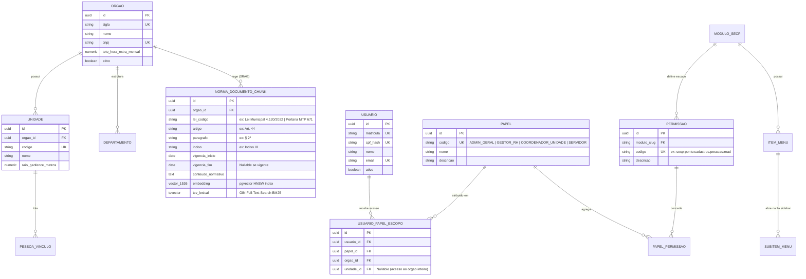

# DATA_MODEL: Modelo Relacional, RBAC Multi-Tenant e Vector Store (SRAG)

- **Identificador**: `SPEC-00-DATA-MODEL`
- **Banco de Dados Alvo**: PostgreSQL 16+ com extensão `pgvector` + Redis 7 (Cache RBAC)
- **ORM / Migrações**: SQLAlchemy 2.0 (Async) + Alembic

---

## 1. Diagrama Entidade-Relacionamento (Mermaid ER)



---

## 2. Estratégia de Indexação Híbrida para o SRAG (`pgvector` + FTS)

1. **Índice Vetorial Denso (HNSW)**:
   ```sql
   CREATE EXTENSION IF NOT EXISTS vector;
   CREATE INDEX idx_norma_chunk_embedding_hnsw
   ON norma_documento_chunk USING hnsw (embedding vector_cosine_ops)
   WITH (m = 16, ef_construction = 64);
   ```
2. **Índice Lexical e Metadados Estruturados**:
   ```sql
   CREATE INDEX idx_norma_chunk_metadata
   ON norma_documento_chunk (orgao_id, vigencia_inicio, vigencia_fim);

   CREATE INDEX idx_norma_chunk_fts
   ON norma_documento_chunk USING gin (tsv_lexical);
   ```
